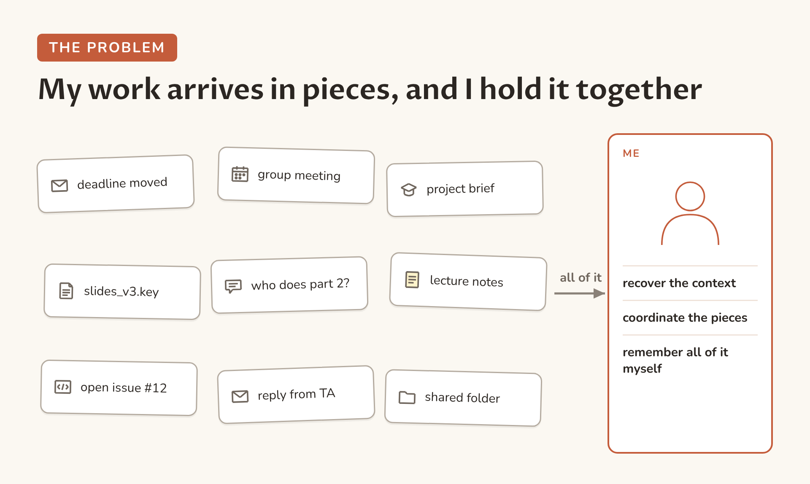
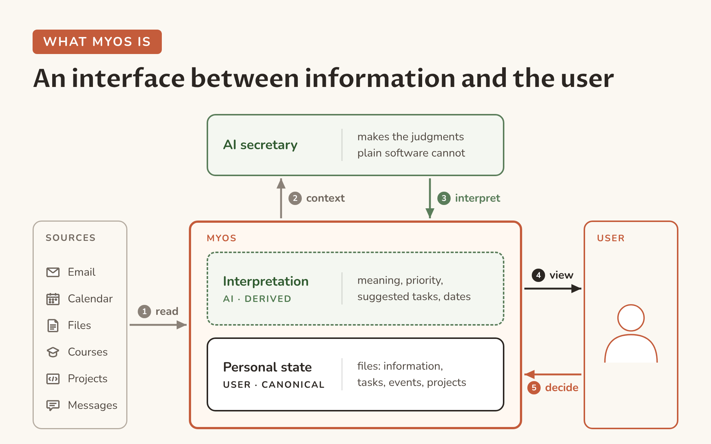
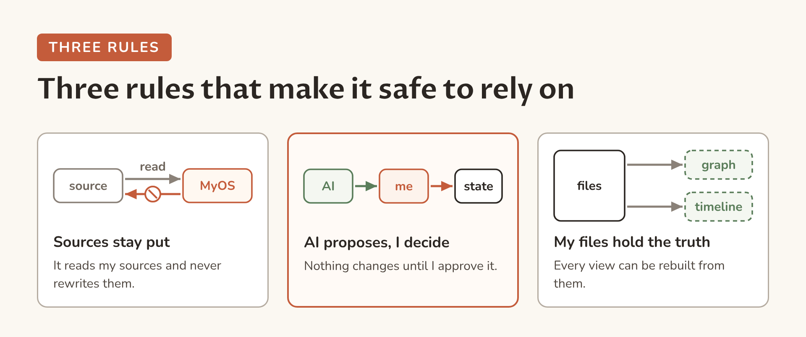
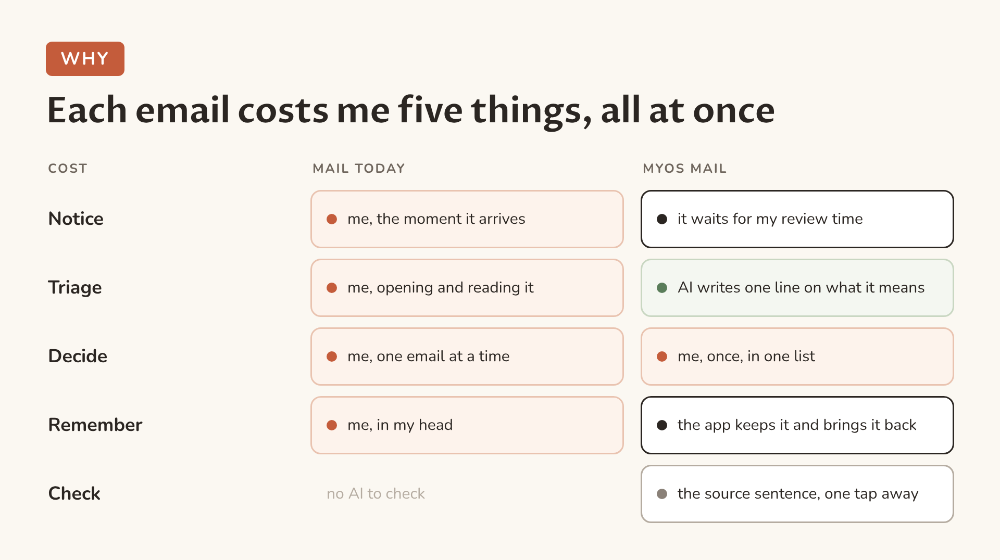
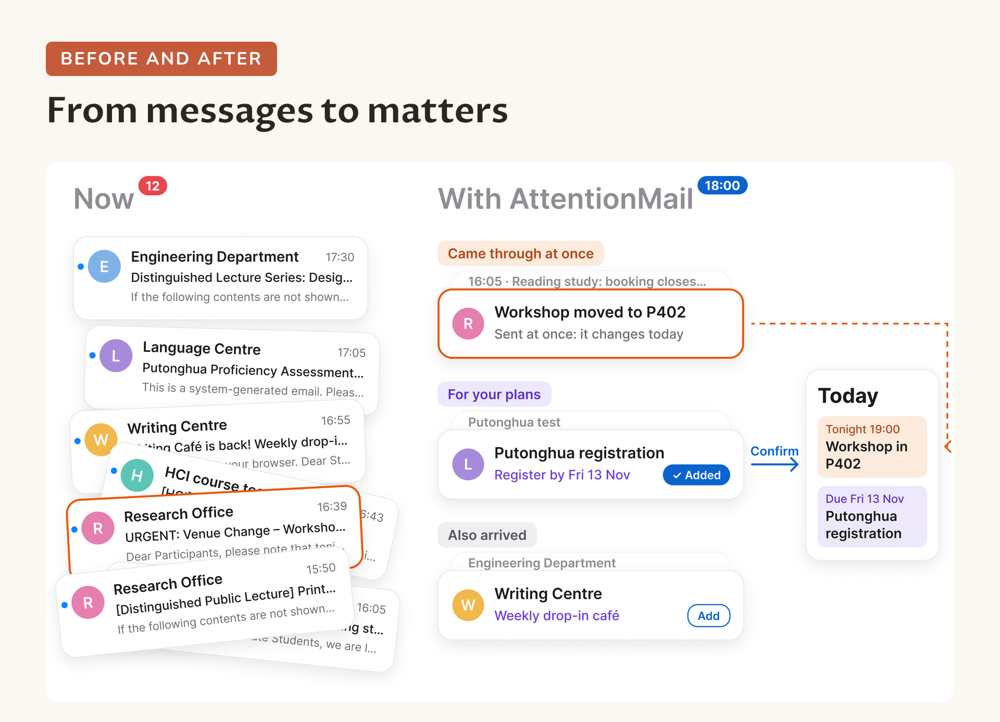
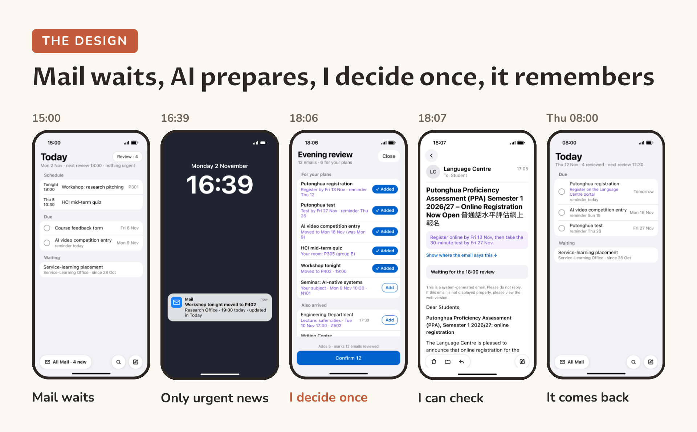
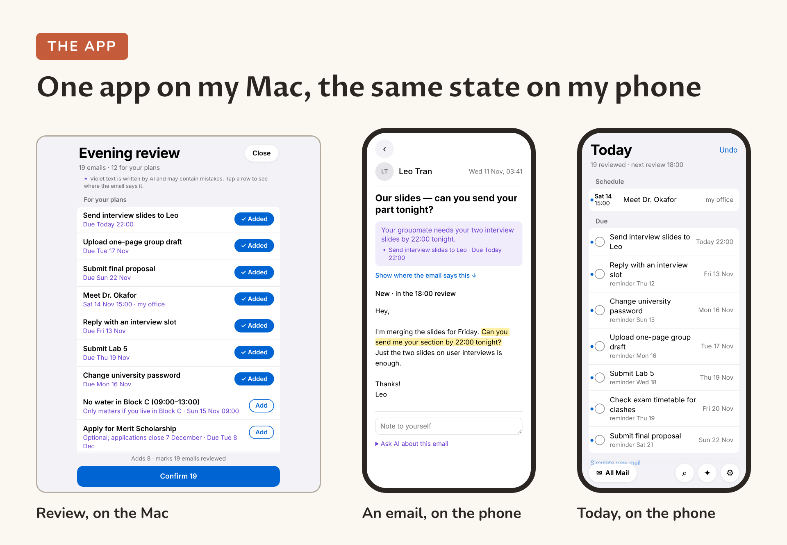

# MyOS

**A personal layer between what I want to do and the information, projects and tools involved in doing it.**

Work in progress: the code and design documents are not public yet. Updated November 2026.

[The idea](#the-idea) · [MyOS Mail](#myos-mail-the-first-piece) · [Still open](#still-open) · [Get in touch](#get-in-touch)

I'm building MyOS for my own work first. It explores how AI can take on the overhead of keeping my work together while I stay in control. "OS" is a metaphor, not an operating system.

## The idea

**Constraints.** Whatever takes over this work must leave me in control, because AI can be wrong. My information must stay mine: readable, traceable and recoverable.

**The open question.** Links, dates and project views have helped people keep track of their work since Bush's memex and early hypertext, but keeping them up to date by hand costs attention. MyOS tests whether AI can do this upkeep cheaply enough once my own checking and corrections are counted. This is a hypothesis, not a result.

**Where it stands.** The model and a small set of design principles are written down; the architecture is still open and will follow from use. The first piece built on them is MyOS Mail.

## MyOS Mail, the first piece

Mail is the first source MyOS works on, because most commitments arrive there.

### Design and philosophy

**Constraints.** Attention is scarce, and interruptions cost more than they last. AI can be wrong, so I must see where each claim comes from. Nothing in my plans may change without me.

The phone design, AttentionMail, is a clickable prototype with made-up emails. It was usability-tested with students, and testing changed how the review status is worded.

### How it is built (ongoing)

One app runs on my Mac and serves the Mac and my phone from the same state. It implements the model and the three rules above. The code is not public yet; the screenshots use its built-in sample of made-up emails.

Two engineering choices follow from the rules above. It reads Apple Mail's own files instead of asking Mail to open messages, so reading can never change my mail. AI notes are stored apart from my decisions, so a new AI answer can never overwrite what I decided.

## Still open

- How to build the personal file system? It still remains a lot of questions (like agent harness) even we constrained it to markdown files with Obsidian philosophy. 
- How to control the boundaries of AI agent while keep human in control?
- The privacy issue.
  
## Get in touch

If you are working on similar ideas or have thoughts on any of this, please open an issue here or reach me through jsx7701@icloud.com.  I would be glad to hear from you.

---

MIT licensed.
